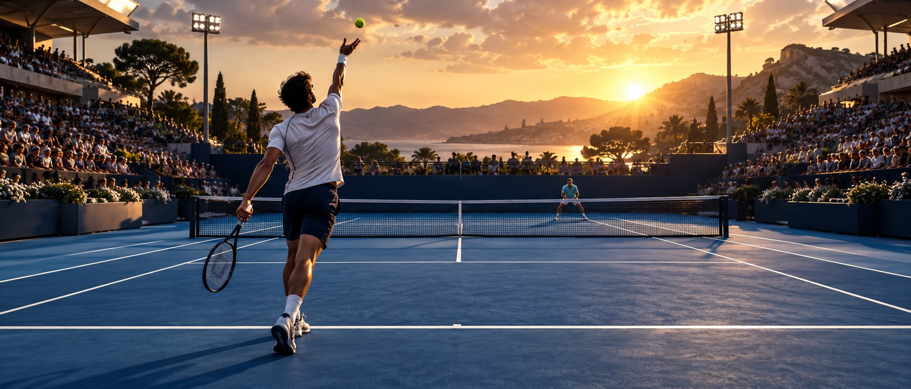
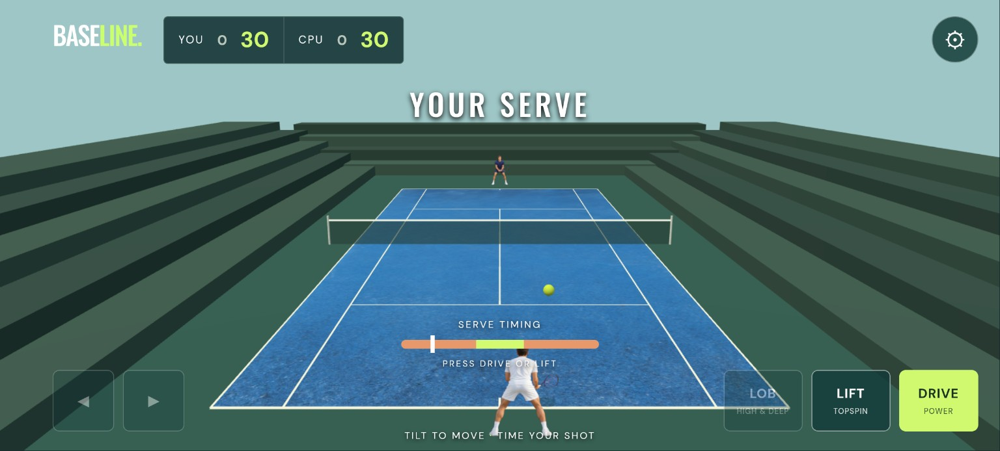
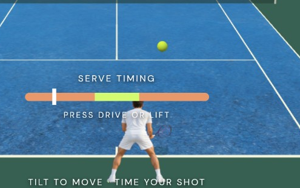

<p align="center">
  
</p>

# Tiebreaker

**A mobile-first, single-player tennis prototype built with three.js.** Play a one-set match against a CPU opponent on hard court, indoor hard, clay or grass. The game is titled **Tie Breaker** in the app.

> The hero above is AI-generated concept artwork. It is not a screenshot of the game. This project is an early prototype: visual fidelity, match balance and physical Android behavior still need work.

## Screenshots

| Prototype match | Serve detail |
| --- | --- |
|  |  |

These are an **earlier build**, captured by the project owner on Android. The second image is a crop of the first, not a separate gameplay capture. Controls and visuals have changed since this screenshot; up-to-date device screenshots are still needed.

## Play

1. Choose a surface and CPU difficulty, then select **Play match**.
2. During your serve, tap **Drive** or **Lift** to start the toss; tap again around the top of the toss to strike.
3. Use the directional pad to move in all four directions. Tap a shot to prepare it while the ball approaches; assisted movement is enabled by default and can be turned off in settings.
4. Hit a legal return, rally and win a one-set match. Use **Lift** for a higher trajectory and **Lob** for a high, deep shot.

On desktop, move with the arrow keys or WASD; press **J**, **K**, **L** (or **1**, **2**, **3**) for Drive, Lift and Lob. Tilt steering is optional and must be enabled in settings. Device and browser support varies.

## Run locally

Requirements: a current browser with WebGL 2, Python 3 to serve static files, and Node.js 18+ to run the tests. The code and its three.js runtime are included; there is no package-install step for the current test suite.

```bash
git clone https://github.com/benclawbot/Tiebreaker.git
cd Tiebreaker
python3 -m http.server 8000 --directory dist
```

Open <http://localhost:8000> in a WebGL-capable browser. `localhost` is treated as a secure context by modern browsers. For testing on another device, serve the app over HTTPS: sensor, wake-lock and installation behavior depend on browser permissions and secure-context support. Opening `index.html` directly via `file://` is not supported.

The app registers a service worker. After an update, reload the page; if an older version persists, close and reopen it or clear the site's cached data in your browser.

## Tests

```bash
npm test
```

The Node test suite checks scoring, service-box logic, faults and lets, movement bounds, shot preparation, simulated rallies across four surfaces, and a simulated full match. It also exercises the view adapter with a mocked renderer. These tests **do not** establish that WebGL renders correctly, that sprites align, or that touch and motion sensors work on a physical phone.

## Architecture

```text
dist/
  index.html, style.css   UI and controls
  game.js                 three.js scene, input and HUD adapter
  match.js                match state, movement, ball physics and scoring
  assets/                 court textures and character / crowd sprites
  sw.js                   offline cache
tests/                    Node simulation and adapter tests
docs/images/              README artwork and prototype screenshots
```

The court and ball are rendered in 3D. Characters are photographic 2D sprite planes with pose transitions; they are not rigged 3D characters. The simulation uses fixed time steps. Surface parameters and the CPU difficulty settings are starting points that require device playtesting and tuning.

## Known limitations

- The current hosted test browser reports its GL renderer as disabled and cannot create a WebGL context; see [the investigation](docs/webgl-investigation.md). That does not prove WebGL is broken on Android devices.
- Real-device validation is still required for serve alignment, animation, touch input, tilt, frame rate, sound, haptics and installability.
- Difficulty is not calibrated: idealized automated matches at higher levels can last excessively long.
- Character poses are sprites, so movement, racket/ball contact and transitions are approximate. The country surface selector is a list rather than the world map in the original specification.
- Tennis rules and ball flight are simplified and should not be treated as a complete tournament simulation. Contributions should include regression tests for rule changes and manual device validation for visuals.

## Third-party notices

The bundled [three.js](https://threejs.org/) files are licensed under the MIT license; see [THIRD_PARTY_THREE_LICENSE.txt](THIRD_PARTY_THREE_LICENSE.txt). The README hero and several in-game assets were generated for this project. No project-wide license is specified yet.
