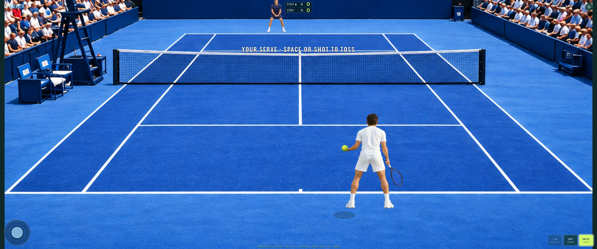
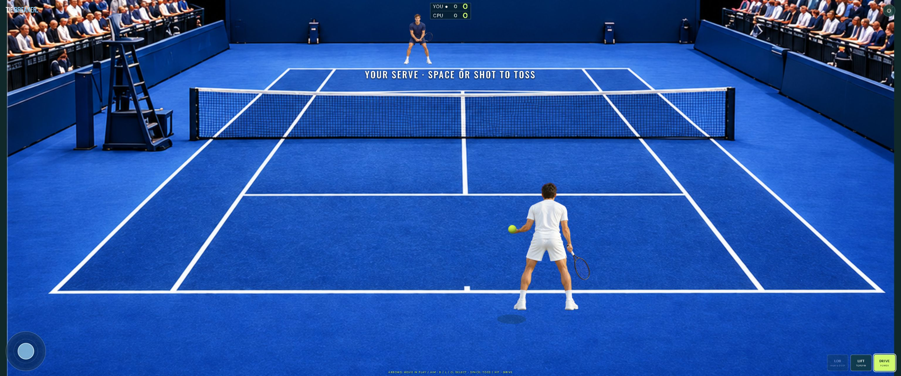
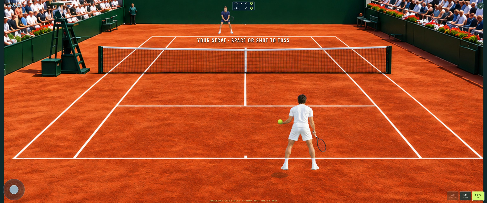
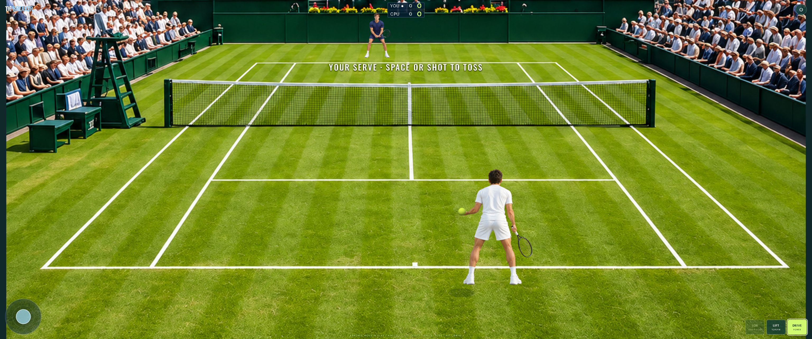

<p align="center">
  
</p>

# Tiebreaker

**A mobile-first, single-player tennis prototype built with three.js.** Play a one-set match against a CPU opponent on hard court, indoor hard, clay or grass. The game is titled **Tie Breaker** in the app.

> The hero above is AI-generated concept artwork. It is not a screenshot of the game. This project is an early prototype: visual fidelity, match balance and physical Android behavior still need work.

## Screenshots

Current gameplay on each surface:

| Outdoor hard | Indoor hard |
| --- | --- |
|  |  |
| **Clay** | **Grass** |
|  |  |

## Play

1. Choose a surface and CPU difficulty, then select **Play match**.
2. During your serve, tap **Drive** or **Lift** to start the toss; tap again around the top of the toss to strike.
3. Drag the virtual joystick to move in all directions. Tap a shot to prepare it, then use the joystick to aim: left/right selects direction and up/down adjusts depth. The marker shows the target; your player moves only when you provide input.
4. Hit a legal return, rally and win a one-set match. Use **Lift** for a higher trajectory and **Lob** for a high, deep shot.

On desktop, use the **arrow keys** to move during play and aim shots. Press **D** for Drive, **L** for Lift or **O** for Lob, then **Space** to hit. During a serve, press Space once to toss and again to strike; serves use Drive or Lift. A focused shot button also responds to Space or Enter. Device and browser support varies.

## Run locally

Requirements: a current browser with WebGL 2, Python 3 to serve static files, and Node.js 18+ to run the tests. The code and its three.js runtime are included; there is no package-install step for the current test suite.

```bash
git clone https://github.com/benclawbot/Tiebreaker.git
cd Tiebreaker
python3 -m http.server 8000 --directory dist
```

Open <http://localhost:8000> in a WebGL-capable browser. `localhost` is treated as a secure context by modern browsers. For testing on another device, serve the app over HTTPS: sensor, wake-lock and installation behavior depend on browser permissions and secure-context support. Opening `index.html` directly via `file://` is not supported.

The app registers a service worker. After an update, reload the page; if an older version persists, close and reopen it or clear the site's cached data in your browser.

## Tests

```bash
npm test
```

The Node test suite checks scoring, service-box logic, faults and lets, movement bounds, shot preparation, simulated rallies across four surfaces, and a simulated full match. It also exercises the view adapter with a mocked renderer. These tests **do not** establish that WebGL renders correctly, that sprites align, or that touch controls work on a physical phone.

## Architecture

```text
dist/
  index.html, style.css   UI and controls
  game.js                 three.js scene, input and HUD adapter
  match.js                match state, movement, ball physics and scoring
  assets/                 court textures and character / crowd sprites
  sw.js                   offline cache
tests/                    Node simulation and adapter tests
docs/images/              README artwork and prototype screenshots
```

Each court uses a supplied stadium image with a calibrated 3D camera. Both players use photographic sprites with blended directional and stroke poses. The experimental rigged 3D renderer and motion-capture data remain in the repository but are not loaded during play. The recordings contain strokes, not running cycles or racket and ball trajectories. Sprite transitions and racket-to-ball alignment remain approximate. The indoor court uses the supplied carpet image with the existing indoor-hard physics settings. The simulation uses fixed time steps. Surface parameters and the CPU difficulty settings are starting points that require device playtesting and tuning.

## Known limitations

- Player movement and strokes use blended photographic sprites; animation transitions and racket-to-ball contact are approximate. The experimental 3D motion-capture renderer is retained separately and is not used in play.
- The indoor court uses a carpet image with indoor-hard physics. Surface behavior and CPU difficulty still need tuning; automated matches at higher difficulties can last excessively long.
- Tennis rules and ball flight are simplified. The location selector is a list rather than an interactive map.
- Physical-device testing is still needed for touch controls, animation, performance, sound, haptics and installation. Browser and device support may vary.

## Third-party notices

The bundled [three.js](https://threejs.org/) files are licensed under the MIT license; see [THIRD_PARTY_THREE_LICENSE.txt](THIRD_PARTY_THREE_LICENSE.txt). The rigged athlete model is licensed under MIT, and the adapted tennis motion recordings under CC BY-SA 3.0; see [model license](dist/assets/mocap/MODEL-LICENSE.txt) and [motion attribution](dist/assets/mocap/ATTRIBUTION.md). The tennis hit and bounce recordings are CC0; see [audio attribution](dist/assets/audio/ATTRIBUTION.md). The README hero and several in-game assets were generated for this project. No project-wide license is specified yet.
